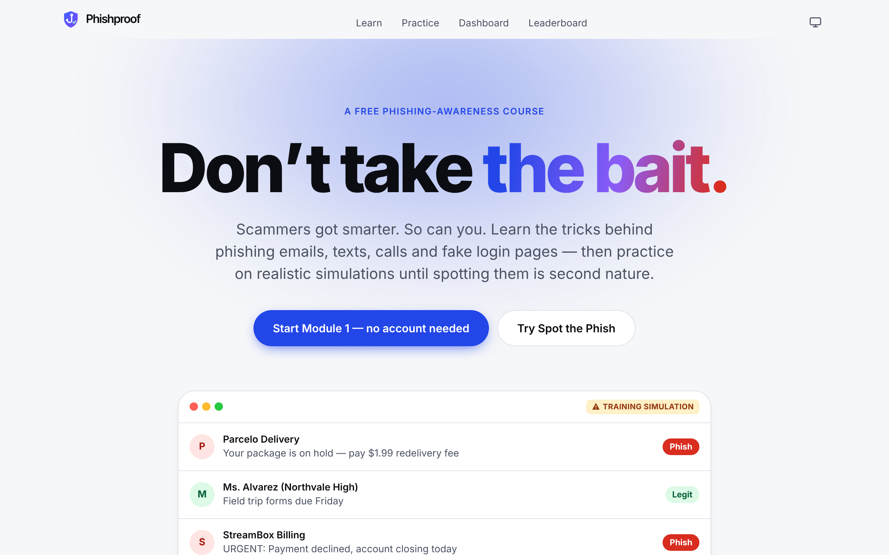
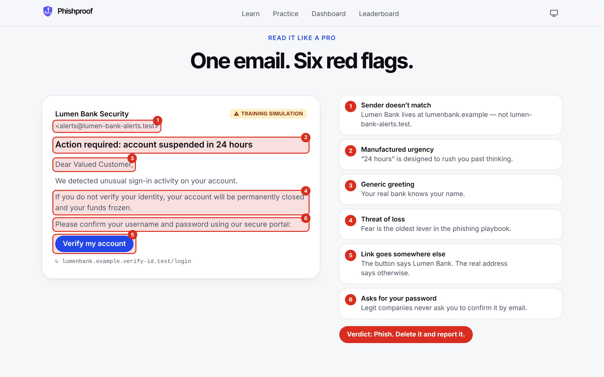
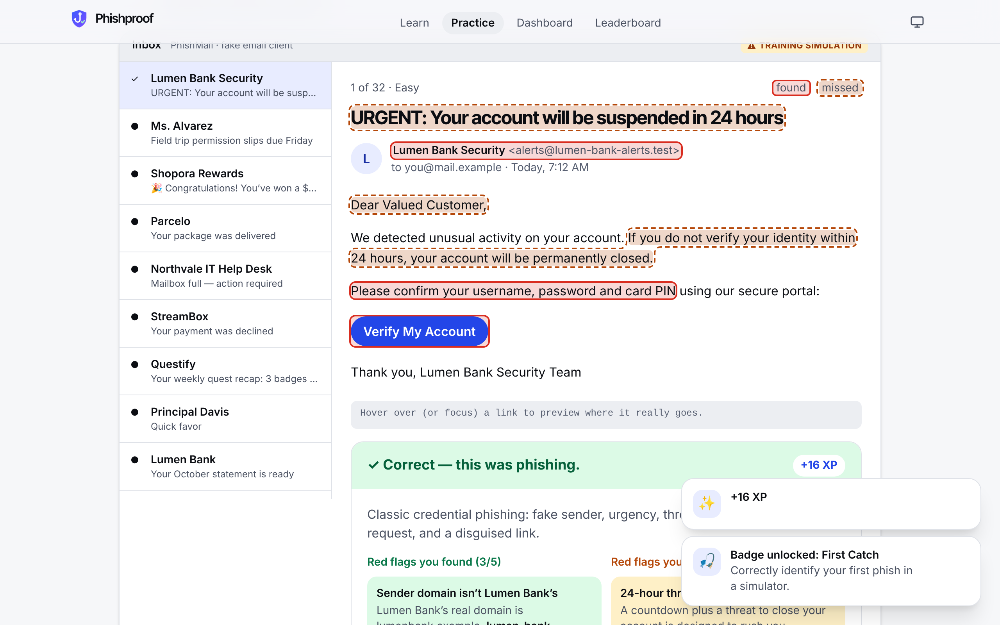
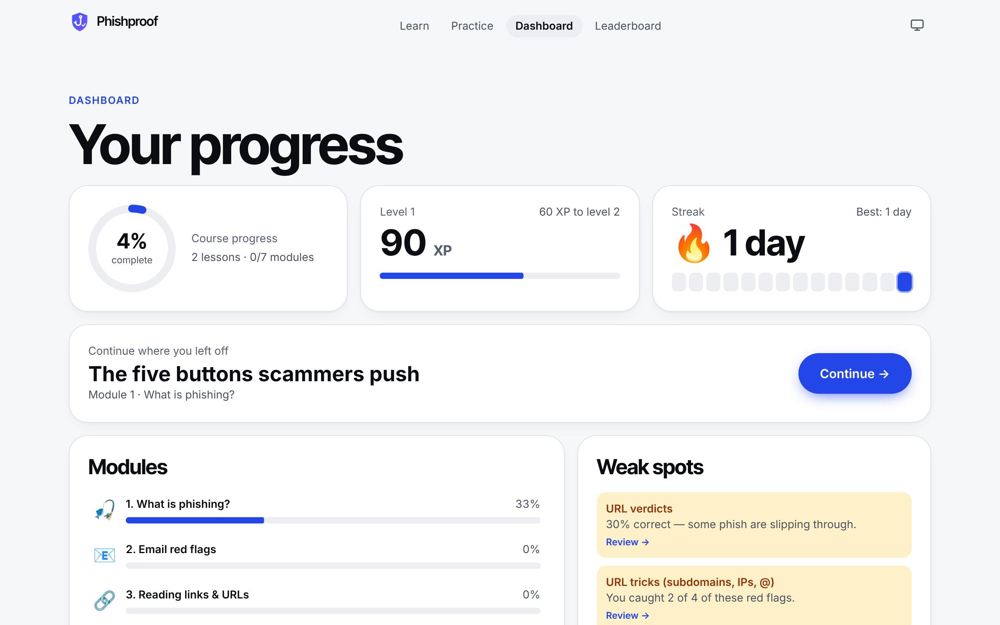
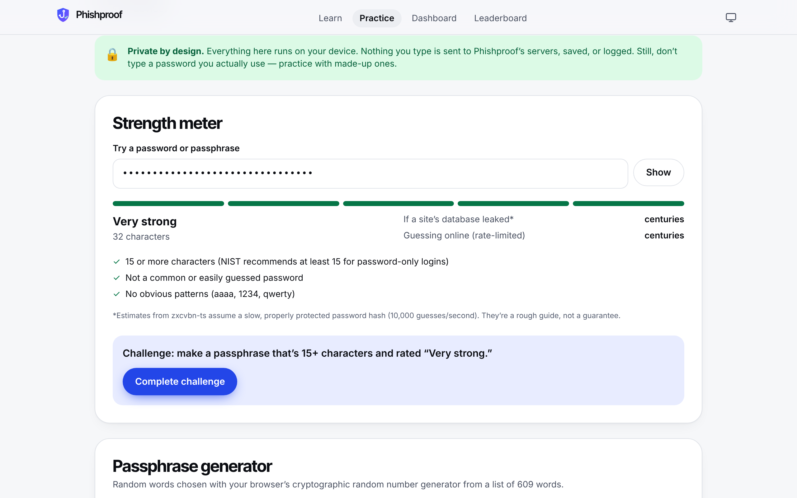
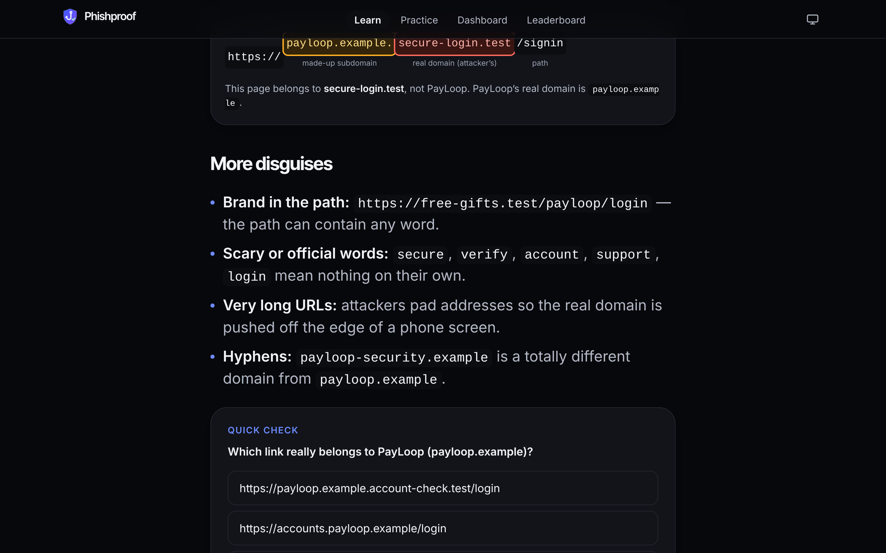
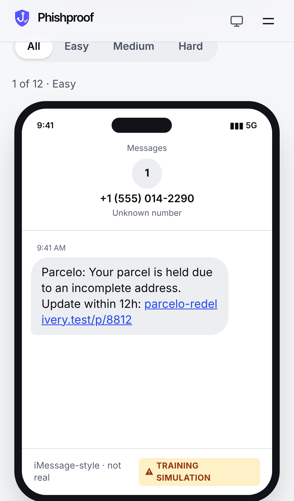
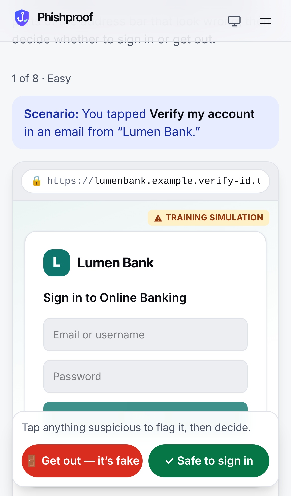
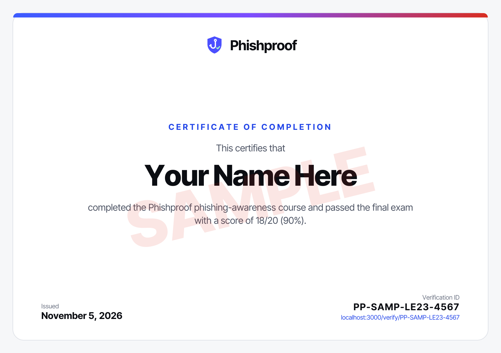

<p align="center">
  
</p>

<h1 align="center">Phishproof</h1>
<p align="center"><strong>Don’t take the bait.</strong> A free, interactive phishing-awareness course with realistic simulators, server-graded progress, and verifiable certificates.</p>

<p align="center">
  Next.js 16 · TypeScript · Tailwind CSS v4 · Supabase (Auth + Postgres + RLS) · Framer Motion · GSAP ScrollTrigger · PWA
</p>

---

## Why I built it

Most breaches start with a person, not a firewall: the Verizon 2026 DBIR found the human element in about 62% of breaches, and phishing in about 16%. I wanted to teach my coding students and TSA chapter to spot phishing the way they’d actually meet it: in an inbox, in a text, on a login page. I also wanted to treat the app itself as a security project, with least-privilege database access, server-side grading, a strict CSP and privacy by design.

## Screenshots

| | |
|---|---|
|  |  |
| **Landing page.** Huge type and an animated inbox that sorts phish from legit. | **Scroll scene.** As you scroll, red flags light up one by one on a fake email (GSAP ScrollTrigger, sticky stage). |
|  |  |
| **Spot the Phish.** Click suspicious parts, call it, see what you found and missed, and why. | **Dashboard.** Progress ring, XP and levels, streak, weak spots, catch rate per red-flag type, badges, recent activity. |
|  |  |
| **Password Lab.** zxcvbn-ts meter and a crypto-random passphrase generator. 100% on-device. | **Lessons (dark mode).** Annotated URLs, comparisons, inline knowledge checks. |
|  |  |
| **Text & DM simulator.** Smishing, fake support DMs, voicemail vishing and QR codes. | **Fake login lab.** Inspect the address bar. Inputs are disabled and labeled as a training simulation. |



**Certificate.** Rendered server-side to PNG and PDF, with an unguessable ID that anyone can check at `/verify/[id]`.

## Features

### The course (7 modules + final exam, 31 lessons, high-school reading level)
1. **What is phishing?** The five emotional triggers (urgency, fear, authority, curiosity, greed), with DBIR statistics.
2. **Email red flags.** Senders, tone and requests, lookalike domains, links and attachments, and why perfect grammar isn’t a safe sign anymore (AI).
3. **Reading links and URLs.** Hover and long-press, URL anatomy, subdomain tricks, homographs and punycode, the padlock myth.
4. **Texts, calls, QR codes and DMs.** Smishing, vishing and AI voice clones, quishing, social and gaming DMs.
5. **Advanced attacks.** Spear phishing, BEC and pretexting, fake login pages (including real-time MFA relay kits), MFA fatigue, deepfakes.
6. **Passwords and accounts.** NIST SP 800-63B: 15+ character passphrases, no forced rotation, breached-password checks, password managers, MFA, passkeys.
7. **What to do.** Resist, Report, Delete; out-of-band verification; an “I already clicked” recovery checklist.
8. **Final exam.** 20 questions, pass at 80%, with a verifiable certificate.

Every module has 3–5 lessons, an interactive drill and a quiz that explains *every* answer choice.

### Simulators
- **Spot the Phish inbox.** 32 emails (13 legit, about 40%) across easy, medium and hard: flaggable senders, Reply-To, subjects, sentences, links and attachments, plus a fake status bar that teaches hovering.
- **Text and DM phone.** 12 messages, including voicemail transcripts and a QR-code preview.
- **Fake login lab.** 8 sign-in pages. Click the suspicious parts of the address bar.
- **URL inspector.** Timed rounds (the timer can be turned off), streak multipliers, keyboard shortcuts, 40 URLs.
- **Password lab.** A strength meter and crack-time estimates using zxcvbn-ts, lazy-loaded, plus a passphrase generator from a 609-word kid-friendly list. Passwords never leave the device.
- **Incident scenario.** A branching “late-night login” story about what to do after a click.

### Accounts and gamification
- Email and password, magic link, and Google sign-in; password reset; account deletion.
- **Guest mode.** Try Module 1 (plus Spot the Phish and the Password Lab) with no account. On sign-up the guest log is **re-graded server-side** and imported.
- **XP and levels, streaks, and 15 badges** (First Catch, Link Detective, Perfect Quiz, 7-Day Streak, Sharp Eye…), with anti-farming rules.
- **Weak spots.** Catch rate per red-flag category, per-simulator verdict accuracy, and low quiz scores, each with a link to the lesson to review.
- **Opt-in leaderboard.** Display name and XP only.
- **Teacher view.** Classes with join codes, a roster with progress, quiz passes, drill accuracy, streaks and certificates, class-wide weak spots, and a CSV export.

### Design
- Original brand and SVG logo, fluid `clamp()` type, frosted sticky nav that shrinks on scroll.
- **Pinned scroll scenes** with GSAP ScrollTrigger. Only `transform` and `opacity` animate everywhere.
- Light and dark themes that follow the system, with a three-way toggle and no flash on load.
- Fully respects `prefers-reduced-motion`: scenes render in their final state.
- Installable **PWA** with icons, shortcuts, and a service worker with an offline page.

## Security & privacy (it’s a security course: it should practice what it teaches)

| Control | Where |
|---|---|
| **Row Level Security on every table.** Users read only their own rows; teachers read only students who joined their class. | `supabase/migrations/*_init.sql` |
| **Server-side grading.** Clients send answers, never scores. The server re-grades from repo content and writes with the service role, so clients have **no write policies** on progress tables and can’t forge XP or certificates. | `src/app/actions/progress.ts`, `src/lib/progress/grading.ts` |
| **Column-level grants.** Users can update only `display_name`, `full_name` and `leaderboard_opt_in`, not `role`, `xp` or streaks. | migration |
| **Narrow `SECURITY DEFINER` functions** (with `search_path = ''`) for joining a class, the leaderboard and public certificate verification. | migration |
| **RLS test suite.** Runs on a real Postgres and checks cross-user reads, XP/role escalation, forged certificates, teacher scoping, anon access and deletion cascades. | `supabase/tests/rls.test.sql` (`npm run test:db`) |
| **Per-request nonce CSP** with `strict-dynamic`, plus HSTS, `X-Frame-Options: DENY`, `nosniff`, Referrer-Policy and Permissions-Policy. | `src/proxy.ts`, `next.config.ts` |
| **Zod validation on every input.** Open-redirect-safe `next` params, IP rate limiting on auth and write actions, no account enumeration. | `src/app/actions/*`, `src/lib/ratelimit.ts`, `src/lib/safe-next.ts` |
| **Safe content rendering.** A tiny markdown subset becomes React elements; no `dangerouslySetInnerHTML` for content. | `src/components/RichText.tsx` |
| **Simulation safety.** Fictional brands only, reserved domains (`.example`, `.test`, documentation IPs), disabled simulated login forms and a “Training simulation” badge everywhere. **Enforced by a content validator and unit test.** | `scripts/validate-content.ts` |
| **The Password Lab never sends passwords.** An e2e test watches every network request while typing. | `e2e/smoke.spec.ts` |

Read the user-facing version at [`/privacy`](src/app/privacy/page.tsx).

## Testing

| Command | What it covers |
|---|---|
| `npm run check` | ESLint, `tsc`, and **36 Vitest unit tests**: quiz and drill grading, XP and anti-farming rules, streak edge cases (month and year boundaries, gaps), badges, weak spots, input validation, content safety |
| `npm run test:db` | Migration + **RLS/privilege tests** on a throwaway Postgres |
| `npm run test:e2e` | **45 Playwright tests**: the smoke flow (guest, plus real sign-up when Supabase keys are set), simulator grading, quiz flow, password privacy, disabled simulated forms, security headers, mobile layout, and **axe-core accessibility scans of 18 pages in light and dark mode** |
| `npm run validate:content` | Content integrity and safety rules |

## Tech stack

- **Next.js 16** (App Router, Server Actions, `proxy.ts`), **React 19**, **TypeScript**
- **Tailwind CSS v4** with CSS-variable design tokens
- **Supabase**: Auth (email/password, magic link, Google OAuth via PKCE) and Postgres with RLS, using `@supabase/ssr`
- **Framer Motion** (`LazyMotion`) for UI motion; **GSAP ScrollTrigger** for the landing page scenes only
- **zxcvbn-ts** for password strength, **zod** for validation, **next/og** + **pdf-lib** for certificates
- **Vitest**, **Playwright**, **@axe-core/playwright**
- Deploys to **Vercel**

## Project structure

```
src/
  app/                 routes (learn, practice, dashboard, exam, certificate, verify, teach, account, auth…)
    actions/           server actions: auth, progress (server grading), certificate, classes, account
  components/          UI, landing scenes, course engine, simulators, dashboard
  content/             ALL course content as typed TS: modules/m1–m7, emails, sms, browser, urls, exam, scenarios
  lib/progress/        pure engine shared by server + browser: grading, XP, streaks, badges, selectors, reducer
  lib/supabase/        browser, server and service-role clients
  proxy.ts             CSP nonce + Supabase session refresh
supabase/
  migrations/          schema + RLS
  seed.sql             generated course catalog (npm run seed:generate)
  tests/               local Postgres RLS test suite
scripts/               content validator, seed generator
tests/unit/            Vitest
e2e/                   Playwright (smoke, mobile, a11y)
```

## Getting started

```bash
npm install
```

```bash
npm run dev
```

That runs the whole site in demo mode, with progress saved in your browser. To turn on accounts, progress sync, certificates and classes, follow **[SETUP.md](SETUP.md)**: create a Supabase project, set the env vars, run the migration and seed, and deploy to Vercel.

## Credits

Created by **Srithan Bodla**, a 17-year-old with a dream to make phishing attacks obsolete. Inter Tight font (SIL OFL). All brands, people and domains in simulations are fictional.
